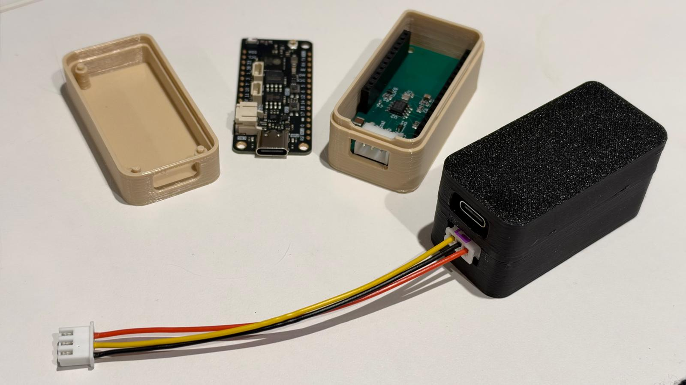

# Case for esphome-lg-controller (FeatherS3[D])

A 3D-printable two-part case for the [esphome-lg-controller](https://github.com/JanM321/esphome-lg-controller) `hardware-FeatherS3` carrier board with an Unexpected Maker [FeatherS3[D]](https://esp32s3.com/feathers3d.html) plugged into its header sockets.



## Files

| File | What it is |
|---|---|
| `lg_controller_feathers3_case.scad` | Parametric OpenSCAD source |
| `lg_controller_feathers3_case.stl` | Ready-to-print base and lid, laid out flat |
| `lg_controller_feathers3_case.jpg` | The printed case (PETG) |

If your build matches the defaults below, print the STL. If not, change the parameters in the `.scad` and export your own.

## Design notes

The dimensions come from the source files, not from photos:

- **Carrier:** from `lg_hvac_esp32.kicad_pcb` in the esphome-lg-controller repo. The board is 22.86 × 50.8 mm with four M2.5 holes on the standard Feather pattern. The 3-pin JST-XH (J1) faces out of the same end as the S3[D]'s USB-C.
- **FeatherS3[D]:** from `FeatherS3D.STEP` in Unexpected Maker's [esp32s3](https://github.com/UnexpectedMaker/esp32s3) repo. It doesn't share the carrier's exact outline:
  - The PCB is 51.26 mm long and sticks out 0.46 mm past the carrier at the antenna end.
  - There are only three mounting holes. The antenna corner has no hole and a 1 mm radius instead of 2.54 mm.
  - The USB-C is centred across the board and overhangs the edge by about 1.5 mm.

The cavity follows the combined outline of both boards. That's why the antenna corner is tighter than the other three and the box is slightly longer at that end.

## What you need

- PETG or ASA filament. Use PLA only if the case will live somewhere that stays cool (see below).
- 4 × M2.5 self-tapping screws, about 6 mm long, to fix the carrier to the base. For heat-set inserts, set `screw_hole = 3.6` and use M2.5 machine screws instead.
- 2 × wall screws (3–3.5 mm) if you use the mounting ears.

## Printing

- Print both parts in the orientation they come in: base on its floor, lid on its roof. No supports needed.
- 0.2 mm layers and 3 walls work fine.
- The USB and JST windows bridge cleanly on most printers. If yours sags, round the slot tops off with `usb_h` and `xh_h`, or print the base with supports enabled only on the end wall.

## Assembly

1. Screw the carrier to the four bosses in the base. Do this before fitting the S3[D], because the S3[D] sits directly over the screw holes.
2. Plug the S3[D] into the carrier's sockets.
3. Plug in the JST-XH lead from the AC unit.
4. Press the lid on until the snap ridges click. Three posts inside the lid rest on the S3[D]'s mounting holes and stop it working out of its sockets.

## Check before you print

The defaults assume a typical header stack. If yours is different, the USB window will be at the wrong height, so measure:

| Parameter | Default | What to measure |
|---|---|---|
| `standoff_h` | 3.5 mm | Clearance under the carrier for through-hole leads |
| `socket_h` | 8.5 mm | Height of the female sockets on the carrier |
| `pin_spacer` | 2.5 mm | Plastic spacer on the S3[D]'s male headers |
| `top_clear` | 6.5 mm | Space above the S3[D]; its tallest part, the JST-PH battery connector, stands 5.6 mm |

Fit adjustments:

- `fit_tol`: lid-to-base clearance per side (default 0.15 mm). Raise it if the lid is too tight, lower it if loose.
- `snap`: snap ridge height (default 0.3 mm). Set it to 0 for a plain friction fit.
- `clr`: gap between the boards and the walls (default 0.5 mm).

Options:

- `mount_ears`: screw ears on each end for wall mounting.
- `lid_posts`: the hold-down posts in the lid.

## Exporting your own STL

Set `part` at the top of the file:

- `"assembly"`: preview with dummy boards (not for printing)
- `"print"`: base and lid side by side
- `"base"` or `"lid"`: one part only

Then render (F6) and export, or from the command line:

```sh
openscad -D 'part="print"' -o lg_controller_feathers3_case.stl lg_controller_feathers3_case.scad
```

## Where to put it

PLA softens with sustained heat, and the lid's fit loosens as it creeps. If the case goes inside the indoor unit rather than on the wall next to it, use PETG or ASA. Inside the unit you also get condensation and a metal enclosure. The S3[D] has a u.FL connector for an external antenna if Wi-Fi struggles in there, but this case has no opening for a pigtail, so you'd need to add a hole in the end wall.

## Credits

- Carrier board and ESPHome component: [JanM321/esphome-lg-controller](https://github.com/JanM321/esphome-lg-controller)
- FeatherS3[D] board and 3D model: [Unexpected Maker](https://github.com/UnexpectedMaker/esp32s3)
